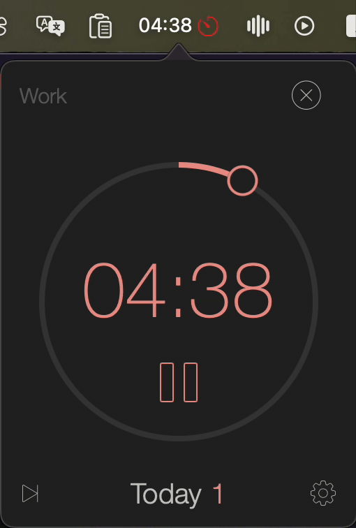
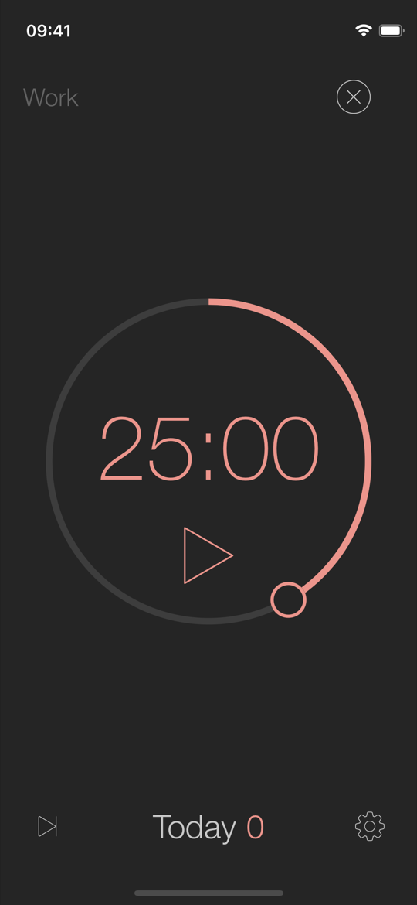
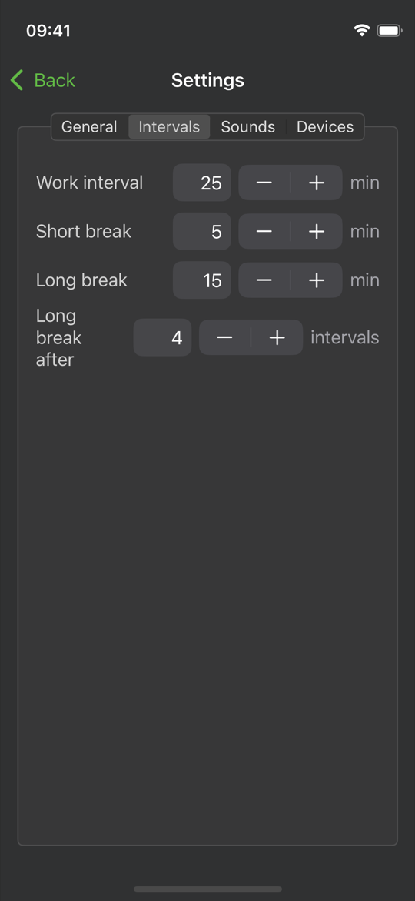

# Pomodoro


[](LICENSE)
[](https://github.com/NikolaevMikhailRoma/mac-AppPomodoroSimple/releases/latest)
[](https://github.com/NikolaevMikhailRoma/mac-AppPomodoroSimple/releases)

A minimal pomodoro timer for the Mac menu bar, Android and iPhone (the Mac app is 1.4 MB). Each app works on its own, and they can be paired.

<p></p>

# Design
The timer is the same everywhere: 
- red while working, green on a break; the Mac's menu bar icon turns grey when stopped. 
- Drag the ring to set the interval (up to 59:59) or tap the digits
to type it. 
- The ▷| button finishes work early and counts it — handy when you
forgot to start the timer — or skips a break. 
- The ⊗ button stops the timer and puts the interval back to its full length.
- Settings: general, interval lengths, the sound and notification, linked devices.

## macOS

Lives in the menu bar: no Dock icon, no main window. Left/Right-click the menu bar
icon, Settings and Quit. Also launch at startup and a light/dark/auto
appearance. Tested by Macbook Pro M1 Max.

<p>
  
  
  
  
</p>

## Android

The same timer on Android 8 and newer. Tested on a Motorola Edge 50 Fusion with Android 16.

<p>
  
  
</p>

## iPhone

The same timer on iOS 17 and newer. Tested on an iPhone 12 mini with iOS 26.2.

<p>
  
  
</p>

## Sync (experimental)

After sync, the Mac and the phones keep one timer: start, pause or drag the ring on one, and the others follow. Interval lengths are shared too; sounds and
notifications stay each device's own.

- Pair once: on the Mac, **Settings → Devices → Pair a Phone…** shows a QR code;
  on the phone, **Settings → Devices → Pair with Mac** and point the camera at it.
- The phones talk to the Mac directly over your Wi-Fi: no servers, no accounts. Everything
  is encrypted with a key made at pairing, kept in the Keychain (Mac, iPhone) or
  under an Android Keystore key.
- A phone syncs while its app is on screen, and for a moment when you press
  pause in the notification shade (Android) or on the Lock Screen (iPhone).
  Android also checks with the Mac before ringing at the end of an interval;
  an iPhone with the app closed does not, so a pause on the Mac does not stop
  its ring.

# Run the app

## For users

Download from the [latest release](https://github.com/NikolaevMikhailRoma/mac-AppPomodoroSimple/releases/latest).

### Mac

macOS 15 or newer.

1. Download `Pomodoro.app.zip`, unzip it and move `Pomodoro.app` to Applications.
2. Open it. The app is not notarized by Apple, будут запрошены разрешения для открытия. Если нет, so macOS blocks the first launch: go to
   **System Settings → Privacy & Security**, click **Open Anyway** under Security
   (the button is there for about an hour) and enter your password.
3. Allow notifications or no:) The timer is in the
   menu bar.

### Android

Android 8 or newer.

1. Download `Pomodoro.apk` on the phone and open it.
2. Allow installing from that app (Files, the browser) when Android asks. Google Play Protect may warn about an unknown app.

### iPhone (Not available)

To build it yourself, see [For developers](#for-developers).

## For developers

Everything builds on a Mac, from the terminal:
* `install.sh` can help you to install app by local network. Without a name, lists the devices it sees.
```
git clone https://github.com/NikolaevMikhailRoma/mac-AppPomodoroSimple.git
cd mac-AppPomodoroSimple
./build.sh                    # all three apps, or one: ./build.sh mac | android | ios
./install.sh mac              # builds Pomodoro.app here and starts it
./install.sh android <name>   # builds Pomodoro.apk here and installs it on that phone
./install.sh ios <name>       # builds the iPhone app and installs it on that iPhone
```

### Requirements:

- **Mac:** macOS 15+, Xcode 16.3+ or just its Command Line Tools (`xcode-select --install`).
- **Android:** JDK 21 and the Android SDK (platform 37), with `JAVA_HOME` and
  `ANDROID_HOME` set; Gradle comes with the project. A phone that `adb devices` lists
  (USB or Wireless debugging), or the emulator.
- **iPhone:** Xcode 16.3+ and `brew install xcodegen`. Your Apple Account in Xcode →
  Settings → Accounts (a free one is enough) with an Apple Development certificate:
  **Manage Certificates… → + → Apple Development**. On the iPhone, Developer Mode on,
  connected to the Mac once. The first time, the iPhone asks to trust the developer:
  Settings → General → VPN & Device Management. With a free account the app runs for
  7 days; `./install.sh ios <name>` again renews it, settings and pairing stay.

The Mac and iPhone apps use only Apple's frameworks; the Android app uses Jetpack
Compose, CameraX and ZXing (for the QR code). Shared code is in `src/`; every colour,
size and icon is in [`config.json`](src/config/Resources/config.json), read by all three.

Tests: `swift test` (Mac and iPhone), `android/gradlew -p android testDebugUnitTest`
(Android), `ios/test.sh <folder>` (clicks through the iPhone app in the simulator and
saves screenshots). The timer and the sync protocol are also checked against shared
test vectors in [`docs/`](docs/), run by both.

Sizes, memory and where each app keeps its settings, counters and keys: [docs/DEBUG.md](docs/DEBUG.md).

# Version history

What changed in each version: [CHANGELOG.md](CHANGELOG.md).

- **0.3.1** — the phones' settings look like the Mac's; smaller and lighter Mac and iPhone apps; `build.sh` and `install.sh`.
- **0.3.0** — experimental iPhone app, sync between the Mac and the phones.
- **0.2.0** — experimental Android app; the Mac app is unchanged.
- **0.1.2** — fixed a crash on launch on another Mac.
- **0.1.1** — ▷| counts a skipped work interval, 59:59 limit with hints, a second copy no longer starts.
- **0.1.0** — first release: menu bar timer, ring, settings, sounds and notifications.

# License

MIT — use it however you like.
